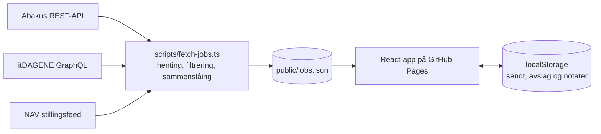

# Jobbradar

En personlig oversikt over sommerjobber, winternships og internships for IT-studenter. Et skript henter nye annonser hver morgen fra Abakus, itDAGENE og NAV, filtrerer bort det som ikke passer, og publiserer resultatet som en statisk nettside. På siden haker jeg av hvilke stillinger jeg har søkt på, og hvilke som har gitt avslag.

**Live:** https://leonc67.github.io/jobbradar/

## Funksjoner

- **Daglig henting** fra tre kilder via GitHub Actions, uten egen server
- **Oversikt øverst** med antall sendte søknader, avslag og ledige stillinger. Trykk på et tall for å filtrere
- **Hake og kryss**: hak av «Sendt» når du har søkt, og «Avslag» hvis du får nei
- **Relevansfilter** som skjuler stillinger for feil årstrinn, utenfor IT eller utenfor ønskede steder
- **Duplikatsjekk** som slår sammen samme annonse fra flere kilder
- **Notater**, egne stillinger (for eksempel fra finn.no), og eksport/import som JSON
- **Personvern**: hakene og notatene lagres bare i nettleseren (localStorage), aldri i repoet

## Arkitektur



Hele løsningen er statisk. En planlagt GitHub Action kjører henteskriptet hver morgen, committer `public/jobs.json` hvis noe er endret, bygger siden med Vite og publiserer den til GitHub Pages.

| Kilde | Hvordan | Merknad |
| --- | --- | --- |
| [Abakus](https://abakus.no/joblistings) | Åpent REST-API (`lego.abakus.no/api/v1/joblistings/`) | Har årstrinn per annonse |
| [itDAGENE](https://itdagene.no/jobb) | Offentlig GraphQL-API, samme spørring som [nettsiden deres](https://github.com/itdagene-ntnu/itdagene-webapp) | Har årstrinn per annonse |
| [NAV](https://arbeidsplassen.nav.no) | Offisiell [stillingsfeed](https://navikt.github.io/pam-stilling-feed/) | Endringslogg, ikke søk. Skriptet husker hvor det kom til i `data/nav-state.json` |

Finn.no er bevisst ikke med. Finn forbyr automatisert henting uten skriftlig samtykke, så annonser derfra legges inn manuelt med «Legg til stilling».

### Filtrering og sammenslåing

1. **Klassifisering** (`scripts/relevance.ts`): hver annonse blir sommerjobb, winternship eller internship basert på kildens type og nøkkelord i tittelen. Faste stillinger, graduate-program og deltid droppes.
2. **Vurdering**: stillinger flagges hvis kilden selv oppgir et annet årstrinn, de mangler IT-ord, eller ligger utenfor stedene i `scripts/config.ts`. Disse skjules som standard, men kan vises. Årstrinn gjettet ut fra fritekst (som «4. året») skjuler aldri en stilling, den vises bare med merket «Sjekk årstrinn», så en feiltolkning som «3. eller 4. året» ikke gjør at stillinger forsvinner.
3. **Sammenslåing** (`scripts/merge.ts`): annonser med samme normaliserte firmanavn og lik tittel (Jaccard-likhet over 0.8, eller generisk tittel som «Sommerjobb Hemit 2027») blir én stilling med flere kilder.
4. **Stabile nøkler**: hver stilling får en nøkkel som gjenbrukes fra forrige kjøring, slik at status i nettleseren følger med selv om annonsen endres.

## Kjør lokalt

```bash
npm install
npm run fetch   # henter stillinger til public/jobs.json
npm run dev     # starter siden på http://localhost:5173
npm test        # tester for parsere, filtrering og sammenslåing
```

Tilpass søkeprofilen (årstrinn, steder, nøkkelord) i [`scripts/config.ts`](scripts/config.ts).

## Oppsett på GitHub

1. Gå til **Settings → Pages** og velg **GitHub Actions** som kilde.
2. Gå til **Actions** og kjør «Hent stillinger og publiser» manuelt første gang.
3. Valgfritt: NAV-kilden bruker NAVs offentlige testtoken, som byttes ut av og til. For et stabilt token, send en e-post til NAV som beskrevet i [dokumentasjonen](https://navikt.github.io/pam-stilling-feed/), og legg tokenet inn som secret `NAV_API_TOKEN` under **Settings → Secrets and variables → Actions**.

## Teknologi

TypeScript, React, Vite, Vitest og GitHub Actions. Ingen backend og ingen database.

## Data og vilkår

Stillingsdata tilhører kildene. Data fra NAV gjengis etter [NAVs API-vilkår](https://arbeidsplassen.nav.no/vilkar-api), og inaktive NAV-annonser fjernes ved neste kjøring.
